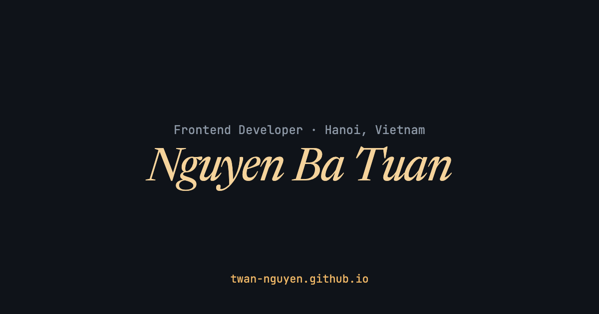

Source code for my personal portfolio: **<https://twan-nguyen.github.io>**

I'm Nguyen Ba Tuan, a frontend developer based in Hanoi. The site is available in English and [Vietnamese](https://twan-nguyen.github.io/vi/).

Built with Next.js, React, TypeScript and Tailwind CSS, and hosted on GitHub Pages. The design is inspired by [zed.dev](https://zed.dev).

## License

The code is released under the [MIT License](LICENSE).

The personal content is not covered by that license: my name, CV details and work descriptions in [`src/data/profile.ts`](src/data/profile.ts), and the images in [`public/`](public/). All rights to them are reserved. If you fork this repository, please replace them with your own.
